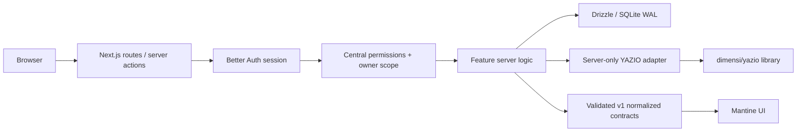

# Data flow

API handlers validate external inputs with Zod. Features never expose upstream payloads or credentials. Return normalized contracts, and use a versioned envelope where responses need evolution. Add v2 alongside v1 for breaking changes; negotiate adoption before changing downstream code. Null nutrition totals mean unknown, not zero and not a guessed calorie calculation.

Future sync: acquire one in-process execution slot, fetch and validate upstream outside the DB transaction, normalize through a research-backed adapter, persist in a short transaction. Jobs contracts exist but no execution is enabled. Multiple app replicas and distributed synchronization are not supported by this foundation.

Local fixtures are marked `source: demo`; only the explicit server demo loader may supply them. It refuses production. No existing page imports or renders fixtures.
