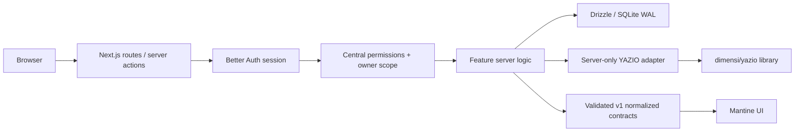

# Data flow

API handlers validate external inputs with Zod. Features never expose upstream payloads or credentials. Return normalized contracts, and use a versioned envelope where responses need evolution. Coordinate breaking contract changes with their callers and replace obsolete interfaces directly; do not add parallel versions solely for backward compatibility. Null nutrition totals mean unknown, not zero and not a guessed calorie calculation.

Future sync: acquire one in-process execution slot, fetch and validate upstream outside the DB transaction, normalize through a research-backed adapter, persist in a short transaction. Jobs contracts exist but no execution is enabled. Multiple app replicas and distributed synchronization are not supported by this foundation.

Local fixtures are marked `source: demo`; only the explicit server demo loader may supply them. It refuses production. No existing page imports or renders fixtures.

## Client reads: accepted direction

[ADR 002](../decisions/002-resilient-client-reads.md) and the [client read cache](client-read-cache.md) define the pending client refactor. Next.js chooses pages. A shared browser data layer publishes loaded resource DTOs from memory/IndexedDB and revalidates through the authorized API; schemas and response parsing live there, not in UI components. A common API error handler clears client state on session expiry or access revoke. Ordinary action denial and network failure are separate outcomes.

The server cannot directly clear browser stores. Cache keys separate accounts and late old-session responses are discarded. No shell, mass snapshot or duplicated route selection is needed. Existing backend authorization and product calculations remain authoritative.
